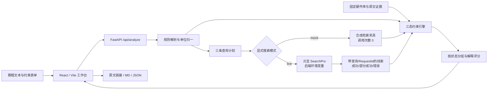

> v0.2已完成TC3真实接入、三案查询/原文核对/截图、主张四态和画像重算。以下为原始实施计划；实际交付与剩余动作见[delivery.md](delivery.md)，不要把旧待密钥状态当当前状态。

# RaceChip AI 开发执行方案

> 2026-10-24 赛前增量计划已更新：后续执行优先采用 [P0/P1 计划 v2](competition-p0-plan-v2.md)，依据见 [竞品复核](competitive-audit-2026-10-24.md)，可复制 [Codex 提示词 v2](codex-prompt-v2.md)。新增主张核验、画像重算与电平语义修正均是待实施任务；下文保留原 P0 记录，不代表 v2 已完成。

版本 P0，编写/执行日期 2026-10-24（北京时间）。截止 **2026-10-25 16:00**。目标用户是第一次参加电子竞赛、已有主控但不熟悉视觉板与资料可信度的新生队伍。主投侦探赛道；官方规则、SearchPro 文档与未确认项见 [核验记录](official-verification.md)。

## 1. 目标与验收

用户输入机器人视觉任务，系统能明确告诉他：识别出什么任务与硬条件、哪些器件有证据覆盖、哪些条件冲突、哪里还不知道、原文从哪里查。最短演示路径可在无密钥时运行，但页面必须写明 MOCK；正式参赛材料必须用 SearchPro 真实模式重新生成。

| P0 验收项 | 可检查证据 | 当前边界 |
| --- | --- | --- |
| Windows 可启动 | setup.ps1 / run.ps1；HTTP 200 | Python/Node 本机依赖 |
| 赛题文本转需求 | 任务、原文摘句、接口/金额/功耗单位、歧义 | 规则解析，仅支持列明的视觉任务 |
| 元宝搜索接入 | 官方固定端点、Bearer、Pages 字符串解析、逐查询记录 | 接口已实现；真实连通需密钥 |
| 参数出处 | 型号、属性、原文 URL、核验日期、官方/社区、核验状态 | 固定人工核验资料库，不自称实时规格 |
| 工程经验 | 真实 OpenMV 论坛 / ESP-WHO GitHub issue | 经验为待复现，不能作为硬规格 |
| 硬约束 | 通过/排除/待核验三态；未知值不按 0 | 性能/完整 BOM 无测量即待核验 |
| 可解释推荐 | 每项检查、评分分解、风险、来源索引 | 人工权重排序，非成功率 |
| 可操作 UI | 四个报告视图、错误/空态/加载、移动布局、MD/JSON | 本机预览，未公开部署 |
| 提交准备 | 一句话介绍、价值/创新、三案模板、脚本、官方清单 | 不代填未发生的真实调用/分享/提交 |

P0 的完成分两层：**代码与 mock 验收**可独立交付；**正式参赛准备就绪**还需真实 API、三案素材和评委可访问作品。不得将两层混称。

## 2. 范围与用户故事

1. 新生贴入文本，确认颜色、巡线、AprilTag 或目标检测任务，检查原文摘句是否正确。
2. 用户在表单补充预算、最大功耗、UART/I2C/SPI/USB/CSI、逻辑电平、离线与禁用器件。文本与表单上限冲突时取更严格值并提示；电平冲突须澄清。
3. 用户选择 mock 或真实模式。三条查询分别覆盖官方型号/引脚、任务与接口、社区调试经验。
4. 用户先看满足条件的候选，再看资料缺失和冲突。不能通过的器件保留排除理由，不进入通过组。
5. 用户打开出处，区分人工核验规格、未核验搜索线索、社区经验与合成检索记录，导出给队友复核。

P0 不解析图片/PDF/表格，不生成主控固件，不声称自动理解整份赛题，不提供实时商城价格，不自动访问任意搜索 URL 并写回规格库。用户可复制已授权的赛题文本；原题版本与参赛合规性需本人复核。

## 3. 技术架构与目录

前端通过同源 `/api` 交互；生产预览由 FastAPI 提供 Vite dist，默认只监听 127.0.0.1:8000。开发时 Vite 代理 8000。P0 不需要数据库；响应与导出即一次调查记录，刷新不会自动保存历史。报告本身可含用户输入，是否分享由用户决定。

| 目录/文件 | 职责 |
| --- | --- |
| backend/app/models.py | 请求长度、数值、接口枚举与约束校验 |
| backend/app/parser.py | 可解释关键词解析、原句引用、金额/mW归一、未建模限制 |
| backend/app/search.py | SearchPro、mock、URL校验、错误码/RequestId/查询记录 |
| backend/app/engine.py | 官方证据检查、硬条件三态、实时检索覆盖、透明评分 |
| backend/app/main.py | API 编排、静态前端、北京时间/案例ID |
| data/catalog.json | 5款板卡，18条原文证据，未知价格/功耗 |
| data/scenarios.json | 3道明确标识的合成练习题 |
| frontend/src/App.tsx | 输入、比较、解析、证据、检索、导出 |
| scripts/ | 安装、启动、验证、打包与离线验收 |
| docs/ / artifacts/ | 方案与材料；官方快照、实际测试记录 |

## 4. 数据、证据与硬约束政策

每个事实保留型号、字段、主张、URL、短摘录、访问日、来源类型和状态。`verified` 表示本轮读取官方文档支持该资料主张，**不是本项目硬件实测**。社区经验始终 `needs_verification`，只生成工程风险与验证项。

真实模式优先给三组搜索线索，每个候选以名称/厂商匹配线索，并对照人工库中官方主机名。只有搜索完整成功且找到对应官方域线索，实时检索覆盖检查才能通过；**官方域匹配仅证明找到该来源，不能证明摘要所含每项参数为真**。参数仍逐字段依赖固定官方证据。无结果、部分失败或配置缺失会使联网推荐保留待核验。这使实时检索实际参与选型状态，又避免把网页摘要直接当规格。

所有网站正文与搜索结果都是资料，不执行其中的指令。React 以文本显示外部摘要，链接仅 http/https；后端不向任意结果 URL 携带密钥。API Key 不入前端、JSON、日志或导出。默认不开公网监听。

| 条件 | pass | fail | unknown |
| --- | --- | --- | --- |
| 预算/功耗上限 | 对应官方/核验证据支持的数值在上限内 | 已证实数值超上限 | null、无对应证据、整机条件未验证 |
| 接口 | 需求接口有官方证据 | P0 不用“文档没写”证明不支持 | 列表不覆盖或证据不足 |
| 逻辑电平 | 官方信号电平一致 | 已证实不一致 | 缺失或输入冲突；供电不能代替信号电平 |
| 视觉任务/离线 | 官方软件路径覆盖 | P0 不把缺示例当硬件绝对不能 | 未覆盖/固件或性能条件待测 |
| 禁用器件 | 未命中已录入项 | 型号/厂商/已知别名命中 | 原题未提供的禁用规则不作保证 |
| FPS/时延/尺寸/整机限制 | P0 不自动通过 | 有明确冲突仍排除 | P0 标额外核验项 |

状态优先级：任一 `fail` → 排除；否则任一 `unknown` → 待核验；否则通过已录入条件。排序先状态，后分数。分数=任务资料覆盖40+人工文档可用性20+新生上手20+官方证据覆盖20，停产扣10、欠货订购扣4；未知库存无加分。它不是物理性能、价格优势或竞赛成功概率。权重需后续真实用户评价再调整。

当前人民币完整成本和统一工况功耗均未核验，保留 null。RT1062 可欠货订购、H7 Plus 停产均来自官方页；不把可订购当作比赛前可送达。数据详见 [provenance](data-provenance.md)。

## 5. 任务分解与依赖

| ID | 优先级 | 任务与完成定义 | 状态/依赖 |
| --- | --- | --- | --- |
| P0-01 | 最高 | 官方规则与 SearchPro 契约、原文快照 | 已实现核验记录 |
| P0-02 | 最高 | Windows 环境、依赖锁、单端口启动 | 已实现，见验收 |
| P0-03 | 最高 | 结构化请求、规则解析、歧义与单位 | 已实现并测试 |
| P0-04 | 最高 | SearchPro adapter、3条查询、失败可见 | 已实现契约测试；真实连通待密钥 |
| P0-05 | 最高 | 固定证据库、社区经验、供应风险 | 已核验资料；未做样机测试 |
| P0-06 | 最高 | 三态过滤、解释评分、来源索引 | 已实现并测试 |
| P0-07 | 最高 | UI四视图、MD/JSON、错误与mock标签 | 已构建，浏览器验收见报告 |
| P0-08 | 最高 | 三条练习题、边界测试、离线smoke | 已实现，测试数量见验收 |
| P0-09 | 提交必需 | 用户在后端环境配置密钥并实际运行 | 等用户本机密钥与额度 |
| P0-10 | 提交必需 | 三案真实检索→录屏/截图→可点击来源 | 依赖P0-09；当前0/3 |
| P0-11 | 提交必需 | 可运行文件包或评委可访问部署 | 源码包可生成；公网部署未执行 |
| P0-12 | 提交必需 | 用户核对队伍/分享条件/表单并正式提交 | 本人账户动作；材料已准备 |

从这份代码继续执行时，先运行 `scripts/verify.ps1` 看当前证据，不要因文档“已实现”就假定真实连通完成。修复失败后只重跑受影响检查；一切状态以实际日志为准。

## 6. 截止前安排（北京时间）

按 10月24日已完成 mock P0 的现状安排。任何延迟优先删除 P1，不压缩真实录屏与首交缓冲。

| 最迟时间 | 必做交付 |
| --- | --- |
| 10月24日 18:00 前 | 本人确认组队与API福利，完成真实连通；若尚无密钥，立即处理账户领取 |
| 10月24日 22:00 前 | 三案真实查询、来源复核、保存MD/JSON与原始截图；收集1名新生试用的原话，没做就不写 |
| 10月25日 10:00 前 | 录制三分钟总演示；源码包在干净目录按README复现；提供实际可打开作品 |
| 10月25日 12:00 前 | 确认队伍成员，停止组队前完成调整 |
| 10月25日 14:00 前 | 本人按适用奖项条件公开分享，填写实际作品/素材链接 |
| 10月25日 15:00 前 | 首次正式提交，保存成功页与时间 |
| 10月25日 15:30 前 | 另一设备/无登录窗口检查链接、文件和来源；必要时重交 |
| 10月25日 16:00 | 官方截止，不把本机保存当作正式提交 |

## 7. P1（P0真实验收与材料完成后才做）

| 顺序 | 功能 | 价值与验收 |
| --- | --- | --- |
| P1-1 | PDF/OCR赛题导入、页码引用、结构化LLM解析可选 | 原句/页码可回溯，规则冲突人工确认；新增供应商前单独决策 |
| P1-2 | 基于缺失字段的第二轮定向检索与原文核对 | 结果引导后续查询；保留每轮证据，才申报“深度调查” |
| P1-3 | 完整BOM与用户报价/实测功耗输入 | 元件数量、相机、电源/运费，日期与工况齐全；不混同测试报价 |
| P1-4 | SQLite历史/同队协作/证据版本 | 断网可查，按用户控制保存/删除；实际体验再扩范围 |
| P1-5 | 漂移/价格监测与通知 | 用户明确选项、真实定时执行、只在有变化通知；P0未实现 |
| P1-6 | 真机性能验证 | 固定光照/距离/分辨率，测端到端FPS/时延与失败样本，再更新结论 |

当前不申报持续监测、截图查证、自动深度多轮调查或硬件实测性能；这些没有实现。
